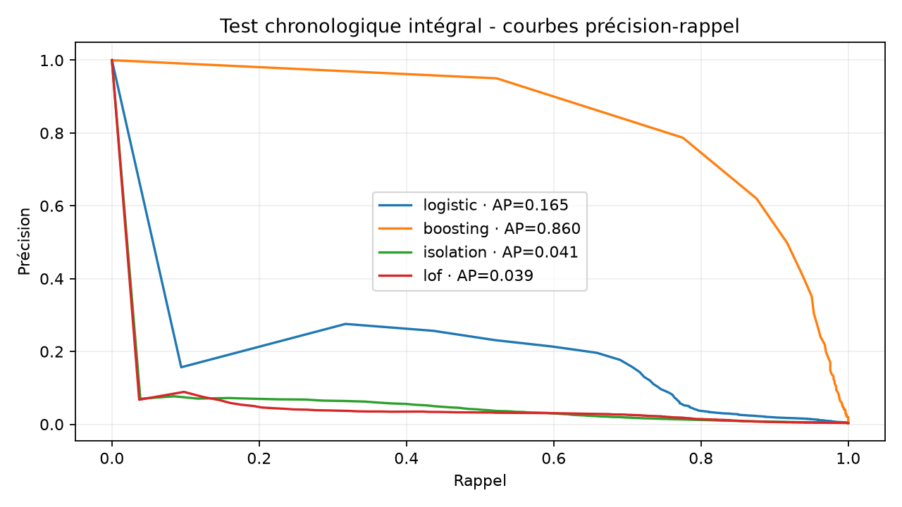
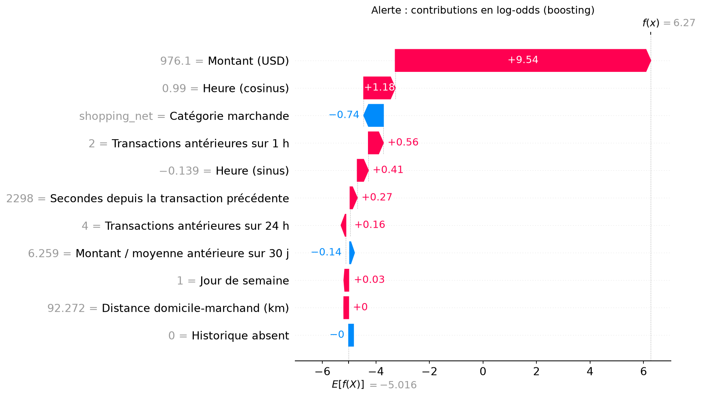

# FraudInsight XAI

Application française de détection de fraude explicable. ENSI, Data Mining, II3-IA / II3-IF, 2026-2027, Challenge 2, Mme Rym Besrour.

Dépôt public indépendant : [AhmedZri/FraudInsight-XAI](https://github.com/AhmedZri/FraudInsight-XAI). Le périmètre publié est décrit dans [docs/PUBLICATION.md](docs/PUBLICATION.md). Le PDF de l’enseignante, les secrets, les données brutes, les prédictions exhaustives de l’audit et les archives privées restent hors Git.

Le cahier des charges privé est `docs/Projet_Challenge_2_Detetion de Fraude_Explicable.pdf` (quatre pages). La [matrice de conformité](docs/CONFORMITE.md) sépare ses exigences des ajouts du commanditaire. Aucun modèle, résultat ou fichier métier de Challenge 1 n’est réutilisé.

## Installation et démonstration Windows

Python **3.11**. Depuis la racine du dépôt, dans PowerShell :

```powershell
py -3.11 -m venv .venv
.\.venv\Scripts\python.exe -m pip install -r requirements.txt
.\.venv\Scripts\python.exe -m streamlit run cloud_app.py
```

Les modèles figés et les 5 000 événements de démonstration sont livrés. Il n’est pas nécessaire de télécharger ni d’entraîner pour démarrer la démonstration. `cloud_app.py` démarre une véritable API FastAPI sur `127.0.0.1:8766`, partagée entre les sessions Streamlit. Aucun entraînement automatique à l’ouverture de l’application. L’API interne surveille son processus parent et s’arrête à sa disparition ; le nettoyage normal termine aussi ses descendants. Fermer Streamlit avec Ctrl+C.

Pour deux processus indépendants, ouvrir deux terminaux :

```powershell
# Terminal 1
.\.venv\Scripts\python.exe -m uvicorn src.api:app --host 127.0.0.1 --port 8766
# Terminal 2
$env:FRAUDINSIGHT_API_URL='http://127.0.0.1:8766'
.\.venv\Scripts\python.exe -m streamlit run app.py
```

Interface : `http://localhost:8501`. Documentation locale FastAPI : `http://127.0.0.1:8766/docs`.

## Jeu de données et licence

Source canonique : [Kartik Shenoy, Credit Card Transactions Fraud Detection](https://www.kaggle.com/datasets/kartik2112/fraud-detection), version 1, produite avec [Sparkov](https://github.com/namebrandon/Sparkov_Data_Generation), par Brandon Harris. Les métadonnées publiques Kaggle ont été enregistrées dans `reports/dataset_metadata.json` : **CC0: Public Domain**, données synthétiques. Le code du générateur a une licence MIT distincte. La simulation couvre des profils de clients américains en 2019-2020 ; elle ne fournit pas de garanties sur des comportements bancaires réels. Les montants sont interprétés en USD conformément au contexte de la simulation ; aucune conversion implicite.

Les deux fichiers originaux sont `fraudTrain.csv` et `fraudTest.csv`. Environ 212 MB d’archive et 502 MB de CSV décompressés selon les métadonnées Kaggle ; les tailles réellement acquises, colonnes, dates, prévalences et empreintes sont consignées dans `reports/source_audit.json`. La cible est `is_fraud`, **1 = fraude**, **0 = légitime**. Le nom historique des fichiers n’impose pas le découpage expérimental : ils sont réunis puis séparés chronologiquement en 60/20/20 pour répondre au projet.

```powershell
.\.venv\Scripts\python.exe scripts/acquire.py
.\.venv\Scripts\python.exe scripts/audit_source.py
```

Le téléchargement utilise **kagglehub**, un handle figé `/versions/1` et un cache **dans ce dépôt** (`data/cache`). Il essaie l’accès public sans secret. Le comportement réellement observé est décrit dans l’audit d’exécution. Selon [la documentation kagglehub](https://github.com/Kaggle/kagglehub), l’authentification concerne les ressources privées ou celles nécessitant un consentement ; ne créez pas de jeton pour contourner une erreur réseau. Si Kaggle change ses conditions ou impose une acceptation, utiliser son interface et un compte gratuit, puis les mécanismes standards kagglehub. Aucun identifiant Kaggle n’est stocké ni inclus dans les livrables.

Les CSV sont lus par blocs de 100 000 lignes, en ne conservant que les colonnes utiles. Prévoir au moins 2 GB d’espace disque disponible et plusieurs GB de RAM pour l’apprentissage complet ; l’entraînement est réservé à la machine locale. Le service de démonstration utilise uniquement les petits artefacts persistés.

## Les six modules

1. **Données** : source/licence, import CSV, quatre indicateurs de volume et montants, distributions par classe, taux quotidien, par heure et catégorie, valeurs manquantes et table sans identités. Aucun canal n’est inventé : la vue canal est explicitement indisponible pour Sparkov.
2. **Préparation** : périodes 60/20/20, définition et disponibilité des variables, avertissements sur l’historique, aperçu des variables d’un CSV importé.
3. **Modélisation** : logistique, gradient boosting histogramme, Isolation Forest, LOF novelty ; comparaison, paramètres, budgets et durées. Le contrôle local d’entraînement est optionnel, protégé par `FRAUDINSIGHT_ALLOW_TRAIN=1`, et lance le script canonique. Redémarrer l’application et l’API après réentraînement pour vider les caches de modèles et de résultats.
4. **Évaluation et coût** : mesures intégrales du test, courbes précision-rappel superposées, coûts validation/test et référence sans alerte. Simulation sur l’extrait affiché avec seuil, capacité quotidienne, coût unitaire et efficacité configurables ; alertes, précision/rappel, F2, MCC, matrice et classement réactifs.
5. **Explications SHAP** : beeswarm et importance absolue moyenne, sélection d’une alerte, waterfall, contributions et motifs positifs réels en français. Pas de motifs inventés pour les anomalies.
6. **API et méthode** : santé HTTP, routes, accès local OpenAPI, limites, export JSON des résultats.

L’import CSV prend `amt`, `category`, une date et une cible 0/1 dont les noms sont configurables. `cc_num` et les coordonnées sont facultatifs. Sans date utilisable, le fichier est rejeté avec une erreur explicite : cette implémentation choisit de ne pas proposer de repli aléatoire. Sans carte, les compteurs sont nuls et l’historique est absent pour chaque événement. Seules les 5 000 premières lignes sont scorées dans l’exploration interactive pour borner les ressources ; l’entraînement et l’évaluation hors ligne ne sont pas limités par cette interface. Un CSV privé n’est jamais écrit sur disque. Les noms, adresses, cartes et coordonnées brutes ne sont pas affichés.

## Reproduction scientifique

```powershell
# Expérience complète : tous les événements, train supervisé complet
.\.venv\Scripts\python.exe scripts/train.py --capacity 50 --investigation 5 --effectiveness 1

# Développement borné : préfixe temporel contigu, sans échantillonnage du test
.\.venv\Scripts\python.exe scripts/train.py --max-rows 100000 --lof-budget 1000
```

Le second mode écrase explicitement les artefacts de l’expérience courante et l’identifie comme **développement borné**. Il ne représente pas une évaluation complète. Ne pas entraîner pendant que l’application utilise ces artefacts. Le script n’utilise aucun label pour choisir les observations ; les budgets des détecteurs prélèvent uniformément dans le seul train avec graine 42. Aucun SMOTE, sous-échantillonnage ni rééquilibrage sur validation/test. Par défaut : IF 50 000 observations, LOF 3 000 ; les méthodes supervisées reçoivent tout le train. LOF est quadratique et coûteux à évaluer ; ces budgets limitent le coût tout en conservant chaque transaction du test naturel. Les résultats mesurent donc les détecteurs **appris sous ces budgets**, pas un LOF entraîné sur un million d’événements.

Les options `--logistic-c`, `--boosting-iterations` et `--lof-neighbors` contrôlent respectivement la régularisation logistique, les itérations du boosting et les voisins LOF ; leurs valeurs sont aussi proposées dans le panneau d’entraînement local. Les changer constitue une nouvelle expérience. Choisir ces valeurs sur le train/validation uniquement, et conserver un nouveau holdout si les résultats test déjà publiés ont guidé la modification.

Le tri est stable. Les limites 60 et 80 % reculent au début du groupe d’horodatages correspondant. Les fractions peuvent donc différer très légèrement de 60/20/20. Aucun ex aequo ne traverse une frontière.

Variables : montant, sinus/cosinus de l’heure (minute incluse), jour de semaine, distance haversine entre domicile et marchand lorsque les coordonnées sont valides, compteurs sur 1 h et 24 h, ratio montant/moyenne des 30 jours antérieurs, secondes depuis l’événement précédent et indicateur d’historique absent, catégorie marchande. Les fenêtres comprennent leur borne gauche et excluent **tous** les événements à l’instant courant. Le ratio est manquant sans observations antérieures ou avec moyenne nulle. La dernière transaction antérieure peut être plus vieille que 30 jours : elle reste valable pour le temps écoulé mais pas pour la moyenne. Les coordonnées invalides donnent une distance manquante.

Les événements antérieurs de toutes les périodes peuvent enrichir les historiques des périodes suivantes, comme dans un flux observable, **sans étiquette**. Les futurs événements et ex aequo ne le peuvent pas. Les cartes servent seulement de clé de regroupement, jamais de prédicteur. Ni identité, adresse, identifiant de transaction, label futur, ni prévalence de test n’entrent dans les variables ou le prétraitement. Les dates naïves de Sparkov sont interprétées dans une horloge commune marquée UTC ; cela n’établit pas leur fuseau d’origine.

Imputation médiane, standardisation et one-hot sont appris uniquement sur le train, catégories inconnues ignorées. Les transformations sont persistées avec chaque modèle. Aucun scaler ajusté sur le test. La logistique (C=1) et le boosting histogramme (100 itérations, 15 feuilles, régularisation L2=1) comparent `class_weight=None` et `balanced`. Ces hyperparamètres conservateurs sont fixés ; seule cette petite comparaison en validation sert à choisir une variante, sans prétendre à une optimisation exhaustive. Isolation Forest (100 arbres, 256 observations/arbre) et LOF (25 voisins, novelty=True) sont ajustés **sans y** sur le train naturel, contaminé éventuellement par de la fraude. `contamination='auto'` définit seulement leur seuil interne, pas la politique opérationnelle.

Pour tous les modèles, un score élevé signifie un risque élevé. Les modèles supervisés utilisent la colonne de probabilité correspondant à `classes_ == 1`. IF et LOF utilisent `-score_samples`. Les probabilités supervisées sont **non calibrées**, particulièrement après pondération ; aucun score d’anomalie n’est présenté comme une probabilité.

## Choix du modèle, du seuil et coût

Le coût hypothétique est :

`Σ montant × is_fraud × (1 − efficacité × alerte) + coût_analyse × nombre_alertes`.

Avec efficacité 100 %, cela devient montants des fraudes manquées + coût des investigations. Avec efficacité 0 %, les alertes ne préviennent aucune perte. Montants USD, exemple 5 USD/alerte, capacité 50 alertes/jour. Ces valeurs sont configurables et **ne décrivent pas une vraie banque**. Le modèle ne chiffre ni friction pour les clients, ni charge fixe, ni délai de récupération, ni montant récupérable spécifique par cas.

La sélection examine exactement chaque groupe de scores distincts en validation, en incluant l’option aucune alerte. Un seuil n’est admissible que si **chaque jour de validation** respecte la capacité. La variante puis le modèle retenus minimisent le coût validation, AP servant à départager. Le seuil est persisté avant toute mesure test ; il n’est jamais retouché pour améliorer le test. Validation et test sont rapportés séparément. Un seuil fixe ne garantit pas la capacité sous dérive : le pic quotidien et un dépassement éventuel sont affichés sans tronquer silencieusement les alertes du test. Dans la seule simulation interactive, une case explicitement nommée permet de plafonner les alertes après classement quotidien rétrospectif : le curseur de budget modifie alors les alertes, précision/rappel et coût. Cette variante ne change aucun résultat scientifique figé et suppose de connaître la journée entière.

AP (Average Precision) est la somme des précisions pondérées par les incréments de rappel, et non l’aire trapézoïdale de la PR. ROC-AUC, F2 (poids accru au rappel), MCC et matrice `[légitime,fraude] × [sans alerte,alerte]` sont également calculés. Précision@k et rappel@k classent les scores au sein de chaque jour pour un budget **jusqu’à k/jour** ; k total est la somme des capacités effectivement utilisées. Ce classement est rétrospectif et ne simule pas un ordonnanceur en ligne. L’interface permet de modifier le seuil sur l’extrait du test : c’est une **exploration**, jamais une optimisation validée.

Résultats numériques et paramètres exacts : `reports/results.json`. Artefacts et empreintes SHA256 : `artifacts/manifest.json`. Le registre n’accepte qu’une liste fermée de modèles locaux ; ne jamais remplacer les joblib par des fichiers non fiables. Une empreinte protège contre la corruption accidentelle, pas contre un attaquant pouvant modifier simultanément modèle et manifeste.

## SHAP

`LinearExplainer` pour la logistique utilise un fond provenant uniquement du train. `TreeExplainer` pour le boosting explique la sortie brute et suit les chemins appris sur train. Les contributions sont exprimées en **log-odds de fraude** ; base + somme = marge et sigmoid(marge) = score supervisé. Cette égalité est vérifiée numériquement, avec tolérance 1e-5. Les contributions one-hot de catégorie sont additionnées en une contribution signée pour préserver l’additivité. La catégorie n’a pas d’ordre numérique : sa couleur est neutralisée sur le beeswarm. Les valeurs manquantes présentées dans les graphiques sont neutralisées visuellement ; le calcul explique bien les variables imputées et transformées du pipeline.

La vue globale est un extrait d’au plus 100 événements uniformément espacés de la démonstration, pas une estimation exhaustive d’importance. Les motifs locaux correspondent aux plus fortes contributions **positives** (jusqu’à cinq ; moins s’il n’y en a pas cinq), pas à des règles métier codées à la main. Les effets négatifs restent visibles sur la waterfall. Une association apprise ne démontre aucune cause ni intention. Explications non supervisées non proposées. Voir [la documentation SHAP](https://shap.readthedocs.io/en/latest/generated/shap.TreeExplainer.html).

## API et schémas

| Méthode | Route | Fonction |
|---|---|---|
| GET | `/health` | Santé et présence du manifeste |
| GET | `/models` | Modèles disponibles, types de score, seuils et noms de variables |
| POST | `/score` | Un événement brut + historique strictement antérieur |
| POST | `/score/features` | Jusqu’à 5 000 lignes de variables déjà construites |
| POST | `/explain` | SHAP d’un événement brut supervisé |
| POST | `/explain/features` | SHAP d’au plus 200 lignes supervisées |
| POST | `/evaluate` | Mesures, coût et classement d’un lot étiqueté, sans retuning |
| GET | `/reports` | Résultats scientifiques figés |
| GET | `/demo` | Extrait sans identités ni cartes |
| GET | `/docs`, `/openapi.json` | Documentation et schémas complets |

Exemple PowerShell, horodatage avec fuseau obligatoire pour l’API :

```powershell
$body=@{
  model_id='boosting'
  transaction=@{trans_date_trans_time='2021-01-01T12:00:00Z'; cc_num='carte-locale'; amt=250.0; category='shopping_net'}
  history=@()
} | ConvertTo-Json -Depth 5
Invoke-RestMethod -Method Post -Uri http://127.0.0.1:8766/score -ContentType 'application/json' -Body $body
```

API sans état d’historique : le client doit fournir les événements antérieurs pertinents pour retrouver les variables de l’apprentissage (30 jours pour les moyennes/compteurs, et dernière opération antérieure si plus ancienne). Une histoire vide signifie absence d’historique, pas récupération automatique des transactions d’entraînement. Les événements simultanés ou futurs dans l’historique sont rejetés. Les schémas interdisent les champs supplémentaires et valeurs non finies, contrôlent les coordonnées et les tailles. Les erreurs ne renvoient pas les valeurs d’entrée ni chemins internes. Le point `/score/features` exige des variables déjà produites selon le contrat ; il ne peut pas prouver la provenance d’agrégats fournis par un tiers. Aucun état privé, apprentissage ou chargement de modèle fourni par HTTP.

## Tests et livrables

L’[acceptation académique finale](reports/ACADEMIC_ACCEPTANCE.md), fondée sur le seul PDF du Challenge 2, réconcilie les métriques, les budgets quotidiens et les coûts sans réentraîner les modèles. Les preuves légères sont dans `reports/academic_audit/`. Les prédictions complètes reconstruites avec les modèles figés sont réservées à la livraison académique privée ; elles ne sont pas nécessaires à l’application publique. Depuis cette livraison privée extraite, leur recalcul indépendant ne nécessite ni Kaggle ni entraînement :

```powershell
.\.venv\Scripts\python.exe scripts/academic_audit.py --replay
```

```powershell
.\.venv\Scripts\python.exe -m pytest -q
.\.venv\Scripts\python.exe scripts/acceptance.py
.\.venv\Scripts\python.exe scripts/deliver.py
.\.venv\Scripts\python.exe -m pytest tests/test_delivery.py -q
```

Le notebook `notebooks/FraudInsight_XAI.ipynb` est exécuté lors de la livraison. Il décrit les dix étapes, reconstruit un exemple historique, rescrore les artefacts et vérifie SHAP. Il n’entraîne pas des millions de lignes à chaque exécution. `scripts/train.py` est l’unique implémentation d’apprentissage. Le rapport `reports/FraudInsight_XAI_une_page.pdf` utilise les résultats JSON réels, puis vérifie une page et produit un rendu pour contrôle visuel. Il est supplémentaire au PDF enseignant.

Les tests couvrent fixtures déterministes (frontières, ex aequo, temps, perturbations futures, cartes nouvelles, dénominateurs nuls), modèles, métriques, coût exact, seuil validation seul, SHAP, HTTP, rechargement, données réelles, notebook/PDF et archives. Les tests marqués `integration` exigent des artefacts authentiques et échouent s’ils sont absents, au lieu de fabriquer des résultats. `reports/acceptance.json` décrit la vérification locale HTTP, les six vues Streamlit et la consommation mesurée ; `reports/tests.txt` conserve le résultat pytest.

La session de construction ne fournit aucun navigateur contrôlable : les captures d’écran complètes de l’interface n’ont donc pas pu être réalisées. Les six vues sont vérifiées avec Streamlit AppTest et appels HTTP réels ; ce contrôle n’est pas présenté comme une capture navigateur. Les figures de démonstration réelles, sans identité ni carte, sont fournies ci-dessous. État détaillé : `reports/acceptance.json`.





Livraison privée : `Challenge2_Detection_Fraude_Explicable_ENSI.zip`. Publication préparée séparément : `FraudInsight-XAI_publication.zip`, sans PDF enseignant. Les archives utilisent une liste blanche ; elles excluent venv, Git, cache Kaggle, CSV bruts, téléversements, secrets et temporaires. Le script vérifie CRC et extraction. Les empreintes de l’archive finale sont dans `reports/archives.json` à côté des archives, pour éviter une dépendance circulaire.

## Déploiement Community Cloud (phase distincte non effectuée)

La publication GitHub est autorisée sur `AhmedZri/FraudInsight-XAI`. Aucun déploiement web n’est réalisé dans cette phase. Pour un futur déploiement autorisé, sélectionner `cloud_app.py` et Python 3.11 dans Community Cloud. Aucune clé ni variable Kaggle n’est nécessaire au fonctionnement. Ne pas activer `FRAUDINSIGHT_ALLOW_TRAIN`. Le dossier `.streamlit` contient le thème et une limite d’import 40 MB.

L’API reste en boucle locale : elle **n’est pas un service public** sur Community Cloud. Les visiteurs utilisent Streamlit qui appelle HTTP depuis le serveur. Le cache de ressources partage le processus API, et les requêtes ne réentraînent pas. Les résultats complets sont précalculés ; l’extrait public est léger et sans identités. Le contrôle de ressources local compare l’arbre des processus à un objectif de 1 GiB ; ce résultat Windows ne garantit pas une limite identique sous Linux ou avec plusieurs visiteurs. [Les ressources Community Cloud peuvent changer](https://docs.streamlit.io/deploy/streamlit-community-cloud/manage-your-app). Un déploiement ne sera déclaré réussi qu’après un vrai test de son URL publique.

## Limites connues

Simulation ≠ déploiement bancaire ; profils et identités synthétiques ne sont pas des personnes réelles mais restent masqués par précaution. Le modèle ignore certains signaux potentiellement utiles faute de disponibilité garantie à la décision. Aucune calibration, validation temporelle répétée, intervalle de confiance, audit d’équité ou surveillance en production. Les détecteurs d’anomalie peuvent manquer la fraude s’ils apprennent surtout la rareté du montant ou de la catégorie. Le test est réutilisable pour démonstration mais ne doit pas devenir une source de retuning. La capacité est un scénario hypothétique ; un seuil fixe peut la dépasser. Le coût de récupération dépend d’hypothèses simplifiées. Pas d’authentification, stockage multi-utilisateur, ingestion continue ni garantie de production dans cette application académique locale.
